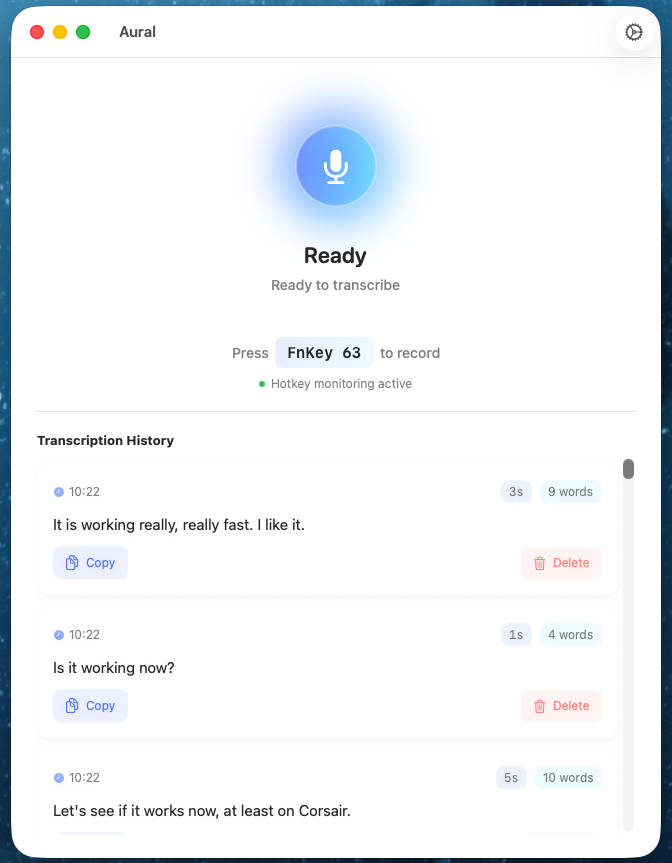

# Aural

<div align="center">


**A modern macOS voice dictation app with AI-powered transcription**

[](LICENSE)
[](https://swift.org)
[](https://www.apple.com/macos/)
[](https://claude.com/claude-code)

Transform speech into text instantly with global hotkeys, custom vocabulary,
voice commands, and powerful AI transcription.

[Features](#features) • [Installation](#installation) • [Usage](#usage) •
[Contributing](#contributing)

</div>

---

<div align="center">



</div>

## ✨ Features

### 🎤 **Core Transcription**

- **Global Hotkey Recording** - Record from anywhere with customizable hotkeys
  (default: Fn key)
- **AI-Powered Transcription** - High-quality transcription using local models (Whisper, Parakeet) or cloud providers (OpenAI, Groq)
- **Local On-Device Models** - Private, free, and offline transcription using Whisper and Parakeet (FluidAudio)
- **Instant Results** - Automatic clipboard copy or direct text injection at
  cursor
- **Modern UI** - Beautiful SwiftUI interface with smooth animations and brand
  design

### ⚙️ **Recording Modes**

- **Hold Only** - Hold key to record, release to stop (classic push-to-talk)
- **Tap to Lock** - Quick tap to start/stop locked recording
- **Hybrid** - Hold for temporary, tap for locked recording (best of both
  worlds)

### 🎯 **Smart Features**

- **Custom Vocabulary** - Define custom word/phrase replacements for
  domain-specific terms
- **Voice Commands** - Natural language commands for punctuation, formatting,
  and editing
  - Punctuation: "comma", "period", "question mark", "exclamation point"
  - Formatting: "new line", "new paragraph", "capitalize", "all caps"
  - Editing: "scratch that", "delete sentence", "undo that"
- **Keyboard Shortcuts** - Quick actions for power users
  - Copy last transcription
  - Show/hide window
  - Clear history

### 💾 **Data Management**

- **Transcription History** - Local SwiftData storage of all transcriptions
- **Metadata Tracking** - Duration, word count, timestamps
- **Copy & Delete** - Manage your history easily

### 🎨 **User Experience**

- **Floating Widget** - Always-visible status indicator with recording state
- **Visual Feedback** - Animated recording indicators with pulse effects
- **Sound Effects** - Audio cues for recording start/stop and completion
- **Dark Mode** - Full support for macOS appearance modes

### 🔒 **Security & Privacy**

- **API Key Storage** - Credentials stored securely in UserDefaults
- **Local Processing** - Audio files processed locally, only sent to API for
  transcription
- **Automatic Cleanup** - Temporary files deleted after transcription
- **No Tracking** - Zero analytics or telemetry

---

## 📋 Requirements

- **macOS 14.0 (Sonoma)** or later
- **Xcode 15+** (for building from source)
- **OpenAI API key** with audio transcription access (gpt-4o-mini-transcribe)
- **Microphone** access
- **Accessibility permissions** (for global hotkey monitoring and text
  injection)
- **Local Models (Optional)**:
  - Apple Silicon (M1/M2/M3) recommended for Parakeet on-device inference.
  - 1-2GB of free disk space for local weights.

---

## 🚀 Installation

### Option 1: Build from Source

1. **Clone the repository**

   ```bash
   git clone https://github.com/javierriveros/aural.git
   cd aural
   ```

2. **Open in Xcode**

   ```bash
   open Aural.xcodeproj
   ```

3. **Build and Run**
   - Press `⌘R` or click the Run button
   - The app will build and launch

### Option 2: Download Release

Pre-built binaries will be available on the
[Releases](https://github.com/javierriveros/aural/releases) page.

---

## ⚙️ Setup

### 1. Get an OpenAI API Key

1. Visit [platform.openai.com](https://platform.openai.com)
2. Create an account or sign in
3. Navigate to [API Keys](https://platform.openai.com/api-keys)
4. Click "Create new secret key"
5. Copy the key (you'll need it in the next step)
6. Ensure you have billing enabled with available credits

> **Note**: OpenAI transcription (`gpt-4o-mini-transcribe`) costs ~$0.003 per minute of audio.

### 2. Configure API Key

1. Launch Aural
2. Click the **gear icon** (⚙️) in the toolbar
3. Paste your OpenAI API key in the secure field
4. Click **"Test API Key"** to verify it works
5. Click **"Save Settings"**

Your API key is stored securely in UserDefaults.

### 4. Local Transcription Setup (Optional)

To enable local on-device transcription, you must add the following Swift Package dependencies to the Xcode project:

1. **SwiftWhisper**: `https://github.com/exPHAT/SwiftWhisper.git` (for Whisper models)
2. **FluidAudio**: `https://github.com/FluidInference/FluidAudio.git` (for Parakeet models)

**To add packages:**
1. Open **File** → **Add Package Dependencies...**
2. Paste the URLs above and add them to the **Aural** target.

Once added, navigate to **Settings** → **Transcription** and switch the mode to **Local**. Use the **Manage Models** view to select and download your preferred models.

### 3. Grant Permissions

#### Microphone Access

Required to record audio. The app will prompt you on first use.

#### Accessibility Permissions

Required for global hotkey monitoring and text injection.

**To grant manually:**

1. Open **System Settings** → **Privacy & Security** → **Accessibility**
2. Click the **lock** to make changes
3. Enable **Aural** in the list
4. Click the **"Retry"** button in the app

---

## 🎯 Usage

### Basic Recording

1. **Hold your hotkey** (default: Fn key) anywhere on your Mac
2. **Speak** your message clearly
3. **Release the hotkey** to stop recording
4. Wait for transcription (usually 1-3 seconds)
5. Text is **automatically copied to clipboard**
6. Paste anywhere with `⌘V`

### Advanced Features

#### Text Injection

Enable in Settings → Text Injection to type transcriptions directly at cursor
position (requires Accessibility permission).

#### Custom Vocabulary

1. Open Settings → Custom Vocabulary
2. Click "Manage Vocabulary"
3. Add entries: "what you say" → "what you want"
4. Enable "Custom Vocabulary"
5. Speak naturally, and terms are automatically replaced

**Example:**

- "API" → "A.P.I."
- "claude code" → "Claude Code"
- "swift U I" → "SwiftUI"

#### Voice Commands

Enable in Settings → Voice Commands

**Examples:**

- "Hello world comma this is a test period" → "Hello world, this is a test."
- "New paragraph The quick brown fox" → "\n\nThe quick brown fox"
- "Capitalize next word hello" → "Hello"
- "Scratch that" → (removes last sentence)

#### Floating Widget

The floating widget shows recording status:

- 🎤 **Gray** - Idle, ready to record
- 🔴 **Red** - Recording (hold mode)
- 🟠 **Orange** - Locked recording
- 🔵 **Blue** - Transcribing

Click the widget during locked recording to stop.

---

## 🏗️ Architecture

### Tech Stack

- **SwiftUI** - Modern declarative UI framework
- **SwiftData** - Local data persistence
- **AVFoundation** - Audio recording and processing
- **UserDefaults** - Configuration and credential storage
- **Carbon/CoreGraphics** - Global event monitoring
- **URLSession** - Network API calls

### Project Structure

```
Aural/
├── Models/
│   ├── AppState.swift              # App state coordinator (@Observable)
│   ├── Transcription.swift         # SwiftData model for history
│   ├── RecordingMode.swift         # Recording mode configurations
│   ├── HotkeyConfiguration.swift   # Hotkey settings and mapping
│   ├── CustomVocabulary.swift      # Vocabulary replacement entries
│   ├── VoiceCommand.swift          # Voice command definitions
│   └── KeyboardShortcut.swift      # Keyboard shortcut configuration
├── Services/
│   ├── AudioRecorder.swift         # Audio recording with AVFoundation
│   ├── CloudTranscriptionService.swift # OpenAI / Groq API integration
│   ├── HotkeyMonitor.swift         # Global hotkey monitoring
│   ├── TextInjectionService.swift  # Accessibility-based text typing
│   ├── VocabularyService.swift     # Custom word replacement
│   ├── VoiceCommandProcessor.swift # Voice command parsing
│   ├── ShortcutManager.swift       # Keyboard shortcut handling
│   └── SoundPlayer.swift           # Audio feedback
├── Views/
│   ├── ContentView.swift           # Main window
│   ├── SettingsView.swift          # Settings configuration
│   ├── FloatingWidgetView.swift    # Floating status widget
│   ├── RecordingIndicatorView.swift # Recording animation
│   ├── TranscriptionRow.swift      # History list item
│   ├── VocabularyManagementView.swift # Vocabulary editor
│   └── HotkeyRecorderView.swift    # Hotkey capture UI
├── Controllers/
│   └── FloatingWidgetController.swift # NSPanel window controller
├── Utilities/
│   ├── Constants.swift             # App-wide constants
│   ├── DesignSystem.swift          # Design tokens and styles
│   └── Extensions.swift            # Utility extensions
└── AuralApp.swift                  # App entry point
```

### Key Design Patterns

- **Observable Pattern** - State management with SwiftUI @Observable
- **Service Layer** - Clear separation of business logic
- **Dependency Injection** - Services injected through AppState
- **Async/Await** - Modern concurrency for I/O operations

---

## 🛠️ Development

### Building

```bash
# Clone the repository
git clone https://github.com/javierriveros/aural.git
cd aural

# Open in Xcode
open Aural.xcodeproj

# Build and run
# Press ⌘R in Xcode
```

### Code Quality

- ✅ Zero force unwraps (safe optional handling)
- ✅ Proper error handling with typed errors
- ✅ Memory leak prevention (weak references, proper cleanup)
- ✅ Thread-safe operations (@MainActor, async/await)
- ✅ Secure credential storage (UserDefaults)
- ✅ Resource cleanup (temporary file management)
- ✅ SwiftLint configured for code quality

### Testing

API key testing uses real audio recording to validate the full transcription
pipeline.

---

## 🤝 Contributing

Contributions are welcome! Please read [CONTRIBUTING.md](CONTRIBUTING.md) for guidelines.

---

## 📝 Changelog

See [CHANGELOG.md](CHANGELOG.md) for version history and release notes.

---

## 🐛 Troubleshooting

### Hotkey Not Working

- **Check Accessibility permissions**: System Settings → Privacy & Security →
  Accessibility
- **Verify no conflicts**: Ensure no other app is using your hotkey
- **Restart app**: Sometimes macOS needs a fresh permission check
- Click **"Retry"** in the permission banner

### Recording Not Starting

- **Microphone permissions**: System Settings → Privacy & Security → Microphone
- **Check other apps**: Close apps that might be using the microphone
- **Try different hotkey**: Change hotkey in Settings if Fn key doesn't work

### Transcription Failing

- **Verify API key**: Use "Test API Key" in Settings
- **Check internet**: Ensure stable connection
- **Check API credits**: Verify billing is enabled on OpenAI platform
- **Audio quality**: Speak clearly and reduce background noise

### Text Injection Not Working

- **Accessibility permissions**: Required for typing at cursor
- **Fallback to clipboard**: App will copy to clipboard if injection fails
- **Try different apps**: Some apps block programmatic input

### Build Errors

- **Xcode version**: Ensure Xcode 15+ with macOS SDK 14+
- **Clean build**: `⌘⇧K` then rebuild
- **Delete DerivedData**: `~/Library/Developer/Xcode/DerivedData`

---

## 📄 License

This project is licensed under the MIT License - see the [LICENSE](LICENSE) file for details.
